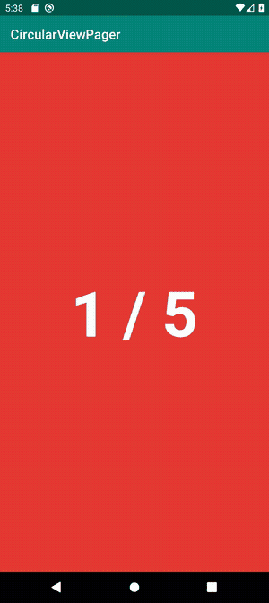

# CircularViewPager

[](https://jitpack.io/#DNights/CircularViewPager)
[](LICENSE)

**KO** 끝에서 처음으로, 처음에서 끝으로 계속 넘길 수 있는 순환(Circular) ViewPager 안드로이드 라이브러리입니다.
**EN** An Android library that lets a ViewPager scroll endlessly, wrapping from the last page to the first and back.

<p align="center"><a href="https://dnight.tistory.com/category/Android"></a></p>

<p align="center"><b>KO</b> 5번째 페이지에서 1번째로, 1번째에서 5번째로 이어서 넘어갑니다. · <b>EN</b> Page 5 wraps to page 1 and back.</p>

📖 **Blog / 블로그** · [DN_Developer – Android 글 모음 / Android posts](https://dnight.tistory.com/category/Android)
<!-- TODO: 이 라이브러리를 설명하는 글을 발행하면 위 줄을 아래처럼 글 링크로 교체하세요.
📖 **Blog / 블로그** · [글 제목](글 URL)
글 아이디어: "ViewPager 무한 순환, 어떻게 만들까 – 원리와 CircularViewPager 라이브러리" -->

> **Origin / 출처**
> **KO** [tompee26/CircularViewPager](https://github.com/tompee26/CircularViewPager)를 기반으로 만들었습니다.
> **EN** Based on [tompee26/CircularViewPager](https://github.com/tompee26/CircularViewPager).
> **KO** 이 버전은 Kotlin + AndroidX로 작성되어 있고, JitPack으로 배포됩니다.
> **EN** This version is written in Kotlin on AndroidX and published via JitPack.

---

## Features / 기능

- **KO** 끝없이 순환하는 페이지 넘김 / **EN** Endless, wrap-around paging
- **KO** 페이지마다 레이아웃 리소스를 지정하는 어댑터 방식 / **EN** Adapter-style API where each page is a layout resource
- **KO** Fragment 페이지용 `setFragmentPagerAdapter()`도 제공 / **EN** Also supports Fragment pages via `setFragmentPagerAdapter()`
- **KO** minSdk 16, AndroidX (`androidx.viewpager.widget.ViewPager` 기반) / **EN** minSdk 16, AndroidX (built on `androidx.viewpager.widget.ViewPager`)

---

## Setup / 설치

**KO** 프로젝트 최상위 `build.gradle`에 JitPack 저장소를 추가합니다.
**EN** Add the JitPack repository to your root `build.gradle`.

```groovy
allprojects {
    repositories {
        google()
        mavenCentral()
        maven { url "https://jitpack.io" }
    }
}
```

**KO** 모듈의 `build.gradle`에 의존성을 추가합니다.
**EN** Add the dependency to your module's `build.gradle`.

```groovy
dependencies {
    implementation 'com.github.DNights:CircularViewPager:1.0.3'
}
```

> **KO** 기존 README의 `jcenter()`는 서비스 종료로 제거했습니다.
> **EN** `jcenter()` from the old README was removed because JCenter has been shut down.

---

## Usage / 사용법

### 1. Layout / 레이아웃

```xml
<dev.dnights.circularviewpager.lib.CircularViewPager
    android:id="@+id/mainViewPager"
    android:layout_width="match_parent"
    android:layout_height="match_parent"
    app:pageCount="0" />
```

### 2. Adapter / 어댑터

**KO** 페이지 레이아웃을 `getLayout()`에서, 내용 바인딩을 `setItemView()`에서 처리합니다.
**EN** Return the page layout from `getLayout()` and bind its content in `setItemView()`.

```kotlin
private fun initMainViewPager() {
    mainViewPager.setLayoutPagerAdapter(object : CircularViewPager.GetLayoutItemListener {

        override fun setItemView(rootView: View, position: Int) {
            // 예: 이미지 로딩 / e.g. load an image
            val imageView = rootView.findViewById<ImageView>(R.id.imageView_thumb)
            Glide.with(rootView)
                .load(listPhoto[position].urls.thumb)
                .into(imageView)
        }

        override fun getLayout(position: Int): Int = R.layout.item_imageview
    })
}
```

### 3. Page count / 페이지 수

**KO** 데이터를 받은 뒤 `pageCount`를 설정하면 페이지 목록이 갱신됩니다. (레이아웃의 `app:pageCount`로 처음 값을 줄 수도 있습니다.)
**EN** Set `pageCount` once your data is loaded to refresh the pages. (You can also give an initial value with `app:pageCount` in XML.)

```kotlin
mainViewPager.pageCount = listPhoto.size
```

> **KO** 예제 앱은 Kotlin synthetics(`rootView.textView_id`)를 쓰지만, 이 방식은 지원이 종료되어 위 예시는 `findViewById`로 바꿨습니다.
> **EN** The sample app uses Kotlin synthetics (`rootView.textView_id`), which are no longer supported, so the example above uses `findViewById` instead.

---

## Sample App / 예제 앱

**KO** `app` 모듈이 예제입니다. [Unsplash API](https://unsplash.com/developers)로 사진을 받아 순환 ViewPager에 보여 줍니다. 실행하려면 `app/src/main/java/dev/dnights/circularviewpager/api/AccessKey.kt`에 Unsplash Access Key를 넣으세요.
**EN** The `app` module is a sample that loads photos from the [Unsplash API](https://unsplash.com/developers) into the circular ViewPager. To run it, put your Unsplash Access Key in `app/src/main/java/dev/dnights/circularviewpager/api/AccessKey.kt`.

---

## License / 라이선스

MIT License © 2019 hyun dong han. See [LICENSE](LICENSE).

---

## 📚 More on the blog / 블로그에서 더 보기

- **KO** 안드로이드 개발 글을 [DN_Developer](https://dnight.tistory.com)에 올리고 있습니다. → [Android 카테고리](https://dnight.tistory.com/category/Android)
- **EN** I write about Android development on [DN_Developer](https://dnight.tistory.com). → [Android category](https://dnight.tistory.com/category/Android)
